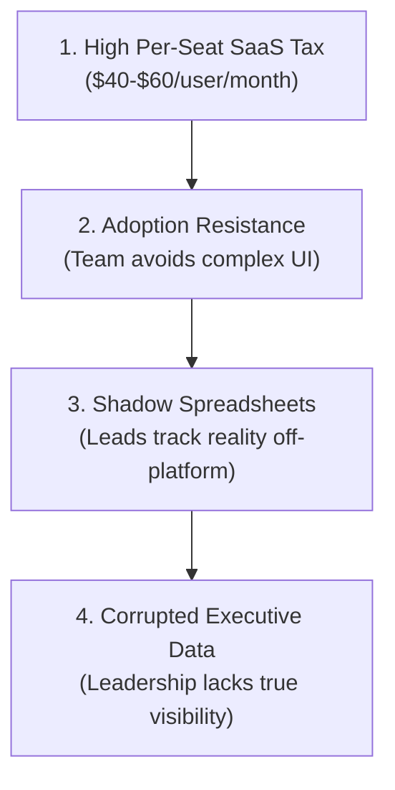
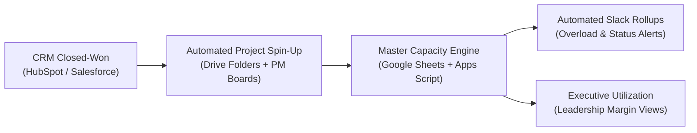

# The Anti-Bloated-PSA Guide: Why 20–150 Person Agencies Abandon $50/Seat Software for Custom Google Workspace Systems

> **TL;DR:** Heavyweight Professional Services Automation (PSA) tools cost $40–$60 per seat each month and frequently turn into abandoned shelfware because delivery teams refuse to update another disconnected platform. By building custom capacity planning and status automation directly inside Google Workspace, Slack, and your existing project tools, 20–150 person agencies gain real-time utilization visibility with zero new software licensing fees.

Every digital agency, technical consultancy, and creative studio reaching 25 to 50 employees hits the exact same operational ceiling. 

In the early days of an agency, staffing and project delivery live inside a single, scrappy spreadsheet managed by the founder or an experienced account director. That spreadsheet works well enough until multi-team client engagements, overlapping sprint timelines, and variable contractor rates overwhelm it. Formulas break without warning, version conflicts emerge across departments, and project managers spend their Thursday afternoons manually chasing project status updates in Slack direct messages.

At that moment, the Chief Operating Officer or Head of Delivery typically makes a costly decision: they purchase an enterprise Professional Services Automation (PSA) platform.

Six months and tens of thousands of dollars later, the agency discovers an uncomfortable reality. The software is cumbersome, the team hates logging into it, and delivery leads have quietly spun up private spreadsheets to track their real day-to-day staffing. The expensive platform has become shelfware.

This guide explains why heavyweight PSA platforms fail inside 20–150 person service organizations, examines the financial breakdown of per-seat software taxes, and illustrates how building native capacity systems inside Google Workspace delivers real-time visibility without operational friction.

---

## The Four Failure Modes of Enterprise PSA Software

Professional Services Automation platforms promise a unified single source of truth across resource planning, project management, time tracking, and invoicing. In practice, they create four major points of failure for agile agencies.



### 1. The Per-Seat Software Tax That Penalizes Headcount Growth
Most PSA platforms charge between **$40 and $60 per user per month**. For a 50-person agency, software licensing alone consumes $24,000 to $36,000 annually. For an 80-person agency, that figure jumps to nearly $50,000 each year.

Worse, agencies frequently operate with a blended workforce of full-time employees, specialized contractors, and external partners. Paying $50 every month for a freelance copywriter or contract engineer who logs three hours of billable work makes no financial sense. As a result, agencies either leave contractors out of the system—blinding leadership to true capacity—or pay an exorbitant tax for occasional users.

### 2. High Adoption Friction Across Delivery Teams
Creative directors, senior engineers, and strategy leads do not want to navigate six dropdown menus just to see who can take a two-week sprint next month. PSA platforms are designed primarily for enterprise billing compliance, not daily creative velocity.

When software requires multi-click workflows for simple schedule updates, team members delay data entry until Friday afternoon. When data is entered under pressure right before weekly leadership reviews, the information is hurried, inaccurate, and outdated before the meeting even starts.

### 3. The Shadow Spreadsheet Inevitability
When a software tool slows down delivery leads, they do what resourceful operators always do: they create shadow spreadsheets. 

Within ninety days of rolling out an enterprise PSA tool, individual team directors almost always build their own private Google Sheets to manage weekly resourcing. The master software tool displays one reality, while the actual projects run on another. The agency is now paying for enterprise software while still enduring the exact manual spreadsheet chaos the software was bought to eliminate.

### 4. Rigid Data Models That Do Not Match Your Process
Every agency structures client engagements differently. Some sell fixed-price monthly retainers with variable milestone sprints; others sell blended hourly time-and-materials contracts with dedicated team pods.

Enterprise PSA tools enforce rigid, monolithic data models. Adapting the platform to your custom delivery lifecycle requires either hiring expensive platform-certified implementation consultants or twisting your internal operating procedures to fit the tool's limitations.

---

## Financial Comparison: Enterprise PSA vs. Custom Google Workspace Engine

To understand why custom operational systems deliver superior returns, examine the three-year total cost of ownership for a 50-person agency:

| Financial Dimension | Enterprise PSA Platform (Kantata, Scoro, Productive) | Custom Google Workspace & Apps Script Engine |
| :--- | :--- | :--- |
| **Annual Software Licensing (50 FTEs)** | $24,000 – $36,000 / year | **$0** (Runs on existing Google Workspace licenses) |
| **Contractor & Freelancer Seat Costs** | $50 / seat / month (Adds $6,000–$12,000/yr) | **$0** (Included seamlessly in shared roster sheets) |
| **Initial Implementation & Setup Fees** | $8,000 – $15,000 upfront | $8,500 – $18,000 (One-time fixed system build) |
| **Ongoing Maintenance & Tweaks** | Requires certified third-party consultants ($150–$250/hr) | Predictable operational retainer ($1,750–$3,000/mo) |
| **Team Training & Ramp Period** | 8 to 12 weeks of training sessions | **< 1 week** (Familiar Google Sheets & Slack interface) |
| **Three-Year Total Cash Outflow** | **$95,000 – $150,000+** | **$29,500 – $54,000** |

The difference is not merely financial. In the custom model, **the agency owns the intellectual property and code entirely**. There are no proprietary lock-ins, no sudden contract renewal price hikes, and no exported CSV data loss if you choose to modify your operational architecture.

---

## The Architecture of a Native Google Workspace Capacity Engine

Rather than forcing teams to abandon spreadsheets completely, a modern operational system transforms Google Sheets from a fragile manual document into a dependable, event-driven database powered by Google Apps Script.



### 1. Centralized Roster & Role Rates
Staff rosters, standard billable targets (e.g., 32 billable hours/week for production roles, 20 hours/week for team leads), and departmental tiers live in a secured master tab. Updating a staff member's target or adding a new contractor automatically recalibrates all rolling capacity views in seconds.

### 2. Multi-Team Allocation Matrix with Live Calculations
Delivery directors allocate team members across projects along a 12-week horizon. Background Google Apps Script functions calculate real-time utilization percentages, immediately highlighting any individual scheduled above 85% (at risk of burnout) or above 100% (critical over-allocation).

Here is a simplified architectural example of how an automated utilization calculator functions inside Google Apps Script:

```javascript
/**
 * Calculates weekly billable utilization across active agency personnel.
 * Automatically flags overallocations and outputs data to leadership dashboards.
 */
function calculateAgencyCapacity() {
  const ss = SpreadsheetApp.getActiveSpreadsheet();
  const rosterSheet = ss.getSheetByName("Roster");
  const allocationSheet = ss.getSheetByName("Allocations");
  const dashboardSheet = ss.getSheetByName("Capacity_Rollup");

  const roster = rosterSheet.getDataRange().getValues();
  const allocations = allocationSheet.getDataRange().getValues();

  const capacityMap = new Map();

  // Populate active team members and their billable weekly targets
  for (let i = 1; i < roster.length; i++) {
    const [id, name, department, role, targetHours, isActive] = roster[i];
    if (isActive === true || isActive === "TRUE") {
      capacityMap.set(name, {
        department,
        role,
        targetHours: Number(targetHours) || 32,
        scheduledHours: 0
      });
    }
  }

  // Aggregate scheduled project commitments
  for (let j = 1; j < allocations.length; j++) {
    const [person, project, weekDate, allocatedHours] = allocations[j];
    if (capacityMap.has(person)) {
      const record = capacityMap.get(person);
      record.scheduledHours += Number(allocatedHours) || 0;
    }
  }

  // Format rollup data for leadership review
  const summaryRows = [["Name", "Department", "Role", "Target Hours", "Allocated Hours", "Utilization %", "Burnout Alert"]];
  capacityMap.forEach((val, person) => {
    const utilPct = Math.round((val.scheduledHours / val.targetHours) * 100);
    const alert = utilPct > 100 ? "CRITICAL OVERALLOCATION" : (utilPct > 85 ? "At Risk" : "Healthy");
    summaryRows.push([person, val.department, val.role, val.targetHours, val.scheduledHours, `${utilPct}%`, alert]);
  });

  dashboardSheet.getRange(1, 1, summaryRows.length, summaryRows[0].length).setValues(summaryRows);
}
```

### 3. Role-Based Permissions & Data Protection
One common flaw of basic spreadsheets is accidental formula deletion. A custom engine uses sheet protection rules and web apps to ensure team leads can only modify allocations for their own personnel, while master calculations and margin rates remain locked to leadership.

### 4. Background Webhooks & Automated Slack Rollups
The engine does not sit isolated in Google Drive. Background scripts pull project updates from Asana, Jira, or Linear and push automated weekly digests into dedicated Slack channels every Monday morning. Leadership sees true capacity and delivery health without anyone having to spend three hours manually copying numbers.

---

## Proven Field Impact: Saving 590 Hours Every Month

The effectiveness of this architecture is grounded in real-world scale. On an enterprise deployment engineered across **17 distinct teams and 37 people via our extended network**, we replaced an array of disjointed scheduling spreadsheets with a custom Google Apps Script capacity and resource planning engine.

The operational results were immediate:
- **~16 hours recovered per person each month**, eliminating redundant status chasing and double-entry scheduling.
- **~590 total billable and management hours returned** to the organization every single month.
- **Zero new software licenses purchased**, running entirely inside their established Google Workspace environment.
- **Full leadership visibility** into upcoming bandwidth three to six weeks in advance, enabling informed hiring decisions.

---

## How to Determine If Your Agency Should Build Instead of Buy

If your firm meets three or more of the following criteria, purchasing an off-the-shelf enterprise PSA tool will likely result in shelfware:

1. **Your team already runs daily communication on Google Workspace and Slack.**
2. **You employ 20 to 150 people** and work with a variable roster of specialized contractors.
3. **Your PMs and delivery leads spend more than four hours every week** manually asking for status updates or updating resourcing workbooks.
4. **You have tried rolling out complex project software in the past**, only to watch your team abandon it within three months.
5. **You want accurate capacity forecasting** without paying tens of thousands of dollars in annual software overhead.

---

## Action Plan: Transitioning to an Automated Capacity Layer

Transitioning away from fragile spreadsheets does not require a six-month software migration. You can build a dependable foundation through three phased steps:

### Phase 1: Audit and Quantify the Bottlenecks
Map your exact workflow from the moment a deal closes in your CRM to weekly status reporting. Calculate the billable hours lost each week to manual data entry and status chasing across your delivery leads.

### Phase 2: Deploy the Core Capacity Engine
Standardize your team roster, role targets, and allocation grid inside Google Sheets. Implement Google Apps Script validation to calculate utilization percentages automatically and alert managers to overallocated staff.

### Phase 3: Connect Your Stack
Add automated webhook triggers that provision project boards and folders when deals hit Closed-Won, and configure automated Monday morning Slack digests to eliminate the Friday status scramble.

---

## Frequently Asked Questions

### Isn't Google Sheets too fragile to run capacity planning for a 100-person firm?
Manual Google Sheets with complex, circular formulas and unlocked cells are fragile. However, an automated Google Workspace engine built with Google Apps Script treats Sheets as a user interface and structured data layer. By moving the calculation logic, data validation, and permission controls into code, the system handles multi-team allocations with complete reliability.

### How does this compare to tools like Kantata, Productive, or Scoro?
Commercial PSA tools provide massive feature sets, but much of that functionality goes unused while introducing high per-seat software costs and heavy adoption friction. A custom Google Workspace engine provides the exact resourcing, capacity, and status visibility your leadership needs without the software tax or user resistance.

### How quickly can a custom capacity system be built?
CaulHaus begins with a **2-Week Workflow & Capacity Audit**, which maps your complete delivery lifecycle and deploys your first working automation prototype. A full custom capacity and delivery operations build typically launches within four to six weeks.

---

## Getting Started with CaulHaus

If your agency or consultancy is losing billable hours to manual spreadsheet updates and status chasing, you do not need another expensive software subscription.

[Explore CaulHaus Services](/services/) to learn how our **2-Week Workflow & Capacity Audit** maps your delivery bottlenecks and deploys your first working prototype, or [get in touch with our team directly](/contact/) to discuss your operational stack.
